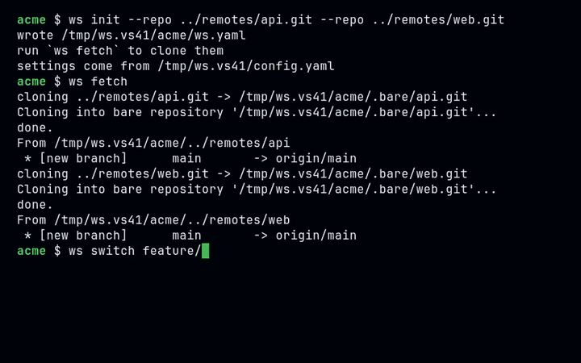

# ws

[](https://github.com/anton-fomin/ws/actions/workflows/ci.yml)

**One branch, every repo.** One command creates a worktree for every repository
of a project in the same branch directory, runs each repo's setup, and opens
your workspace in tmux or [herdr](https://herdr.dev).

[](https://ws.fomin.space)

```
ws init --global                                   # once: your settings
ws init --repo git@github.com:org/api.git --repo git@github.com:org/web.git
ws fetch
ws switch feature/JIRA-123
```

```
acme/
  ws.yaml
  .bare/api.git  .bare/web.git     # one bare clone per repository
  main/api       main/web          # a branch directory per branch...
  feature-JIRA-123/api             # ...holding one worktree per repository
  feature-JIRA-123/web
```

## Features

- **Every repo, one branch directory.** Keep worktrees side by side, like
  `project/feature-login/backend` and `project/feature-login/frontend`, instead
  of managing each repository's worktrees separately.
- **Automatic dependency installs.** npm, pnpm, Yarn and uv install packages
  in new worktrees. pnpm and Yarn reuse dependencies through hardlinks from
  the worktree you switched from, falling back to the default branch's worktree.
- **Remote branches, ready locally.** `ws fetch` fetches every configured repo;
  `ws switch <branch>` creates worktrees from the remote branch where it exists.
- **Tasks across repos.** Define `dev` in a Taskfile, justfile or `package.json`,
  then run `ws run dev` to start it in every repo that declares it, in parallel,
  with combined, repo-prefixed terminal output.
- **Logs your agent can read.** Enable `logs.enabled: true` to save all
  `ws run` task output to files, or use `ws run dev --logs` for one run.
- **Local files, without the copying ritual.** Keep `.env`, `.npmrc` and other
  untracked files in `local/`, then symlink or copy them into your worktrees.
- **Custom setup commands.** Run per-repo commands once when a worktree is
  created—for example, decrypt SOPS secrets into a `.env` file.
- **A home for CLI lovers.** Create or focus a tmux session or herdr workspace
  for each branch, with a window or tab per repo and a shared one at the branch
  directory root for multi-repo workspaces.
- **Pick and jump.** Find local and remote branches with fzf through `ws pick`,
  or jump to worktrees with zoxide.
- **Skills for coding agents.** Use `/ws <task>` to have an agent prepare a
  workspace and start a fresh agent there; the companion workspace skill
  teaches agents how to navigate it and run tasks.
- **Written in Rust.** Blazingly fast, of course.

## Install

On Linux or macOS:

```
curl -fsSL https://github.com/anton-fomin/ws/releases/latest/download/install.sh | sh
```

Linux (x86_64 and arm64, static musl builds that run on any distribution) and
macOS (Intel and Apple Silicon). Windows is not supported. The installer checks
each download against its SHA-256 file, and the script is attached to every
release if you would rather read it first.

Nix, pinned versions and installing by hand are in
[Getting started](docs/getting-started.md). `git` is the only requirement;
tmux, herdr, fzf, zoxide and the package managers are optional integrations.

## Documentation

**https://ws.fomin.space** has the documentation for every release. The same
pages are in [`docs/`](docs/) here, as of this commit:

- [Getting started](docs/getting-started.md): install, shell wrapper, a first workspace
- [Layout](docs/layout.md): what goes where on disk
- [Commands](docs/commands.md)
- [Configuration](docs/configuration.md): `ws.yaml`, the global config, setup commands
- [Integrations](docs/integrations/index.md): [multiplexers](docs/integrations/multiplexers.md),
  [fzf and zoxide](docs/integrations/fzf-zoxide.md),
  [local files](docs/integrations/local-files.md),
  [package managers](docs/integrations/package-managers.md)
- [Tasks](docs/tasks.md): `ws run` and its logs
- [Shell completion](docs/shell-completion.md)
- [Coding agents](docs/coding-agents.md): the `/ws` launcher and the workspace skill

## Contributing

See [CONTRIBUTING.md](CONTRIBUTING.md).

## Inspiration

Inspired by [sesh](https://github.com/joshmedeski/sesh) and
[worktrunk](https://github.com/max-sixty/worktrunk).

## License

Licensed under either of [Apache License, Version 2.0](LICENSE-APACHE) or
[MIT license](LICENSE-MIT) at your option. Unless you explicitly state
otherwise, any contribution intentionally submitted for inclusion in `ws` by
you, as defined in the Apache-2.0 license, shall be dual licensed as above,
without any additional terms or conditions.
